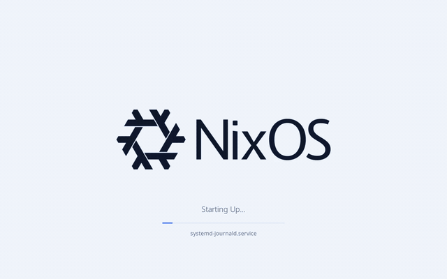
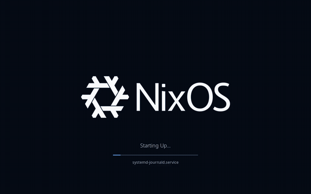

## X-Plymouth

This repo contains a plymouth theme for NixOS that pulses the NixOS logo. Please check out the credits section for all the work that inspired this.

It comes in a light and a dark scheme that match the [X-Login](https://github.com/x-tech-laboratories/X-Login) greeter's Halon theme, plus the original black and white look. The logo, its glow colour and the number of boot status lines can all be changed.

| Light (default) | Dark |
| --- | --- |
|  |  |

Classic:


# Install

The package is currently not in nixpkgs.

## Flakes

You can include it in your `flakes.nix` like this:

```nix
{
  inputs.x-plymouth.url = "github:x-tech-laboratories/X-Plymouth";;
  outputs = { self, nixpkgs, x-plymouth }:
  {
    nixosConfigurations."<hostname>" = nixpkgs.lib.nixosSystem {
      modules = [ 
        x-plymouth.nixosModules.default 
        ... 
      ];
      system  = "x86_64-linux";
    };
  };
}

```

## Non Flakes

You can include it in your `configuration.nix` like this:

```nix
{ config, lib, pkgs, ...}:
let
  # Fetch the repository
  x-plymouth-src = pkgs.fetchFromGitHub {
    owner = "x-tech-laboratories";
    repo = "X-Plymouth";
    rev = "main";
    sha256 = "sha256-<hash>";
  };
in
{
  imports = [ "${x-plymouth-src}/default.nix" ];
}
```

## Configuration

No configuration is needed. The theme will automatically enable plymouth and set the theme to itself.

Every setting is optional:

```nix
x-plymouth = {
  variant = "dark";          # "light" (default), "dark" or "classic"
  logo = ./my-logo.svg;      # SVG or any image ImageMagick reads; defaults to the NixOS logo
  logoRecolor = true;        # paint the logo in the scheme's text colour; false keeps its own colours
  logoWidth = 614;           # logo width on screen in pixels, glow excluded
  glowColor = "#f59e0b";     # colour of the pulsing glow; defaults to the scheme's accent
  statusLines = 5;           # boot statuses listed under the progress bar; 0 hides them
};
```

Plymouth runs before any desktop session, so it cannot follow the system's colour scheme; the variant is fixed here.

The status lines list what systemd reports to Plymouth, which is the name of each unit it starts (`NetworkManager.service`, not "Started Network Manager"), along with anything sent through `plymouth display-message`. The newest is on top and older ones fade out.

## How the theme works

Everything is drawn by one script for Plymouth's script module, [src/x-plymouth.script](src/x-plymouth.script). The two-step module would be simpler, but it draws all text in white, which is unreadable on the light scheme.

At build time, [x-plymouth.nix](x-plymouth.nix) turns the logo into two images of the same size:

- `logo.png`: the logo trimmed to its shape, scaled to `logoWidth`, and painted in the scheme's text colour unless `logoRecolor` is off.
- `glow.png`: the logo's shape blurred twice (σ = 2 and 15 px at 614 px wide, scaled with the width), combined, and filled with the glow colour.

At boot the script stacks the glow under the logo and fades its opacity through a 6 second cycle. It rises over 2.5 s, holds for 0.5 s, falls over 2.5 s and rests for 0.5 s, easing in as p^1.75. Those numbers reproduce the hand-animated frames the theme used to ship, which were made in Inkscape and xyris.app from the [NixOS logo](src/nixos-logo.svg) with two blurred copies.

The scheme colours are X-Login's Halon tokens, kept in `x-plymouth.nix`. The password dialog icons are rendered from the SVG templates in [src/icons/](src/icons/).

## Testing the changes

Once your host system has been configured:

1. Update your flake
2. Rebuild your system `using nixos-rebuild`
3. Run the following `sudo plymouthd ; sudo plymouth --show-splash ; sleep 10 ; sudo killall plymouthd`

## Credits

* Creating Glows in SVGs - www.youtube.com/watch?v=oe8RB4Y6Vi4
* NixOS-Boot - https://github.com/Melkor333/nixos-boot
